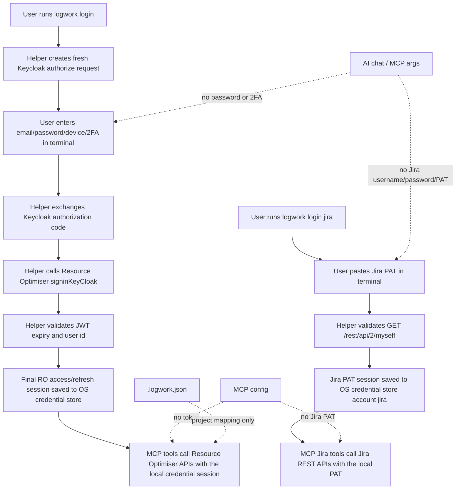

# Security And Auth

logwork-cli does not accept or store Bearer tokens in config files. Resource Optimiser login and Jira PAT login both run in Terminal.

## Auth Setup

Start login:

```bash
logwork login
```

What happens:

1. The helper creates a fresh Keycloak authorization request.
2. You enter Resource Optimiser email and password in Terminal.
3. You choose the 2FA device in Terminal.
4. You enter the 2FA code in Terminal.
5. The helper exchanges the Keycloak authorization code.
6. The helper calls Resource Optimiser `signinKeyCloak`.
7. The helper stores the Resource Optimiser access/refresh token session in the OS credential store.

Check auth status without printing the token:

```bash
logwork status
```

Delete the stored token:

```bash
logwork logout
```

## Auth Notes

- Password and 2FA are never accepted through MCP tool inputs or AI chat.
- Password and 2FA are never stored.
- Keycloak URLs contain dynamic `state`, `nonce`, `execution`, and `tab_id` values. Do not hardcode or paste them into config.
- Keycloak access tokens are intermediate only and are not stored.
- Only the final Resource Optimiser access/refresh token session is stored in the OS credential store: macOS Keychain on macOS, or Windows Credential Manager on Windows.
- Auth does not open or read any browser profile.

## Jira PAT Setup

Jira self-hosted worklogs use a Jira Personal Access Token. The default Jira base URL is:

```text
https://jira-vnv.vinova.sg
```

Start Jira auth:

```bash
logwork login jira
```

Use a different Jira URL only when needed:

```bash
logwork login jira --base-url https://jira.example.com
```

What happens:

1. You paste the Jira Personal Access Token in Terminal.
2. The helper validates the token with `GET /rest/api/2/myself`.
3. The helper stores `{ baseUrl, token, user }` in the OS credential store under service `logwork-cli`, account `jira`.

Check or delete Jira auth without printing the token:

```bash
logwork status jira
logwork logout jira
```

Sessions saved by `logwork-helper` (service `logwork-helper`) are read once and copied to service `logwork-cli`, so an upgrade does not require a new login. `logwork logout` removes both entries.

Jira username/password login is not supported in MCP. Do not paste Jira passwords, PATs, cookies, or raw Jira auth logs into AI chat.

## Auth Security Flow



## Stored Files

The runtime and local state live in `~/.logwork-cli` (`%USERPROFILE%\.logwork-cli` on Windows). `LOGWORK_HOME` overrides this location, and the older `LOGWORK_HELPER_HOME` is still honored. When upgrading from `logwork-helper`, the state files below are copied once from `~/.logwork-helper`, which is left in place.

| File | Content |
| --- | --- |
| `.logwork.json` | Project mappings: ticket prefixes and keywords. A repo-level `.logwork.json` (or a legacy `.logwork-helper.json`) holds project-scope mappings. |
| `manual-drafts.json` | Terminal UI drafts. |
| `apply-ledger.json` | Sanitized apply history. |
| `update-state.json` | Update check cache: package name, latest SemVer, and check timestamp. Expires after 24 hours and contains no npm credentials. |
| `reminder.json`, `reminder-state.json` | Reminder config: enabled state, local time, target and weekdays. Last-run state: sanitized timestamps and status summaries. |
| `diagnostics/` | Sanitized diagnostics reports from `logwork doctor`. |

The apply ledger stores the target, flow target, batch ID, timestamp, workspace path, entry metadata, and submitted/failed/blocked status. It does not store credentials, cookies, or raw API responses, and token-like error text is redacted before writing.

The macOS launch agent and Windows scheduled task contain only fixed Node and script paths (`bin/logwork.mjs reminder run`). They never contain RO tokens, Jira PATs, passwords, or API responses.

## Safety Model

**Where secrets are never stored**
- Tokens are not stored in MCP config or in `.logwork.json`.
- The email address may be remembered in the OS credential store to prefill the next login.

**How MCP writes are gated**
- Every MCP write is two calls to the same tool. The first call, without `confirm`, returns a cached preview with a `batchId` or `previewId`. The second call must pass that id with `confirm: true`, which the assistant sends only after explicit approval.
- The apply call writes the cached preview as-is. It rejects content fields such as `text` or `hours`, so nothing can be changed after approval without a new preview.
- `edit_entry` preserves the project and date. It rejects entries that are Jira-created, rejected, or on a locked day, and stale-checks the original entry.
- `edit_entry` apply replaces the entry: it creates the corrected entry first, then deletes the original, and rolls back the new entry if the delete fails. It then verifies the new entry.
- `log_work` (Resource Optimiser) and `log_jira_work` (Jira) are separate flows. Applying Resource Optimiser logwork does not write Jira worklogs.
- Jira duplicate detection is blocking and has no override option.

**Read-only tools**
- `get_logwork`, `list_projects`, `list_tasks`, `get_jira_issue`, `reconcile`, and `get_history` are read-only.
- Reconciliation accepts preset periods only, filters Jira worklogs to the stored Jira user, and never applies its correction suggestions directly.

**Updates**
- `update` with `action: "check"` is read-only.
- `update` with `action: "install"` requires `confirm: true`, re-checks npm latest, accepts only an exact SemVer, and cannot receive an arbitrary registry or shell command.
- Installation preserves local files and OS credential-store entries. The current MCP process must be reconnected after a successful update.

**Reminder**
- `reminder` with `action: "status"` is read-only.
- `enable`, `disable` and `test` require `confirm: true`. They never accept arbitrary scheduler commands, paths, JQL, or credentials.
- The background reminder reads RO and Jira sessions from the OS credential store only when it runs. Notification and state text are sanitized and never include raw API responses.

**Login and diagnostics**
- `login` never accepts credentials. It only opens or explains a terminal login.
- Diagnostics reports redact tokens, cookies, passwords, OTPs, auth codes, and raw HTML.
